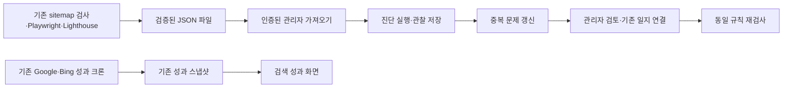

# DIVERKYU SEO Intelligence — 요청서 검토와 어드민 접합안

2026-11-28 KST · 개정 2. 도구/파일 계약 구현, **어드민 접합 방향 사용자 승인**. 1차 구현 단계와 2차 키워드 확장 경계를 확정했다. 승인과 기능 구현 완료는 별개다.

**개정 4 — 1-1 운영 반영:** PR #78 병합 main `671fed2`의 Production Ready를 확인하고, 사용자 승인에 따라 운영 0009를 적용했다(10/10). SEO 6개 화면과 기존 콘텐츠·설정 읽기 검증을 마쳤다. [운영 검증·남은 API 설정](../operations/2026-11-28-seo-admin-production.md). 앞선 [dev CRUD·로그인·주소 저장 검증](../operations/2026-11-28-seo-admin-integration.md)과 운영 읽기 검증을 구분한다. Google/Bing 실제 성과 수집은 미연동이며 1-2~1-5는 아직 후속 단계다. 아래 최초 도구 도입 시점의 기록을 현재 운영 완료 범위로 확대 해석하지 않는다.

## 검토 시작점 — 완료 여부와 다음 순서

**1. 현재 전체 페이지 SEO 수정·보완 완료: No.**

- 당시 운영 공개 페이지 18개를 점검했고, 페이지별 검색 제목/설명·공유 이미지·작성자/인물·사이트맵 보완을 [PR #76](https://github.com/diverkyu/personal-branding/pull/76)에 구현했다. 단위 616건·E2E 377건 통과(기존 환경별 skip 19건).
- 2026-11-28 사용자 병합 후 fetch로 [검사 PR #75](https://github.com/diverkyu/personal-branding/pull/75)와 #76의 main 병합을 확인했다(`6029acb`). #77에도 이 main을 통합한다. 운영 배포 성공 및 전체 URL 재검증은 이번 충돌 수정에서 확인하지 않았으므로 전체 SEO 완료라고 하지 않는다.
- 작품별 실제 줄거리·제작기와 코론 실제 대표 사진 등 확인 대기 항목이 있다. 기술 수정 완료와 콘텐츠 보강·운영 반영·검색엔진 실제 색인은 각각 별개다.
- [페이지별 문구와 전체 점검표](https://github.com/diverkyu/personal-branding/blob/feat/seo-page-content/docs/operations/2026-11-28-seo-content-review.md)에서 수정 내역과 남은 사항을 검토한다.

**2(a). SEO 스킬셋 제작: Yes.** 요청한 외부 스킬 5개와 `diverkyu-seo-audit` 전용 스킬을 프로젝트에 설치/작성했고 문서 검증을 통과했다. 현재 Codex 채팅의 자동 탐지 및 `$diverkyu-seo-audit` 호출 확인은 아직 남아 있다.

**2(b). 플러그인·도구 상태는 다음과 같다.**

| 도구 | 파일/패키지 준비 | 실제 실행 | 현재 사용할 때 남은 것 |
| --- | --- | --- | --- |
| Chrome DevTools MCP 1.14.0 | npm 고정 버전 다운로드·실행, 프로젝트 MCP 설정 작성 | stdio 연결·33개 도구 조회·운영 홈 접근 성공 | 현재 Codex 호스트에 도구가 노출됐는지는 미확인. 저장소 문맥에서 인식 확인 필요 |
| Playwright MCP 0.0.86 | npm 패키지 실행 및 설정 작성 | 프로토콜 연결 시험까지 수행 | alpha 엔진 확인 후 사용자 결정으로 기본 비활성화. 추가 설치/활성화는 당장 필요 없음 |
| 기존 Playwright 테스트 1.65.0 | 이미 설치돼 있던 도구 유지 | 기존 페이지 SEO E2E에 사용 | MCP와 별개의 자동 테스트로 계속 사용 |
| Lighthouse CI 0.16.1 | 앱 개발 의존성에 설치·버전 고정 | 로컬 공개 화면 3개×3회 측정, JSON 보고서 생성 | 원격 Actions 실행과 운영 기준선은 별도 확인 |
| GitHub Actions | 실행 파일 작성·PR 연결 | [최초 PR 실행 성공](https://github.com/diverkyu/personal-branding/actions/runs/46143602270) | main 통합 후 새 실행은 별도 확인. 주간/월간 자동화는 아직 설계 단계 |

이는 Codex 앱 마켓플레이스에서 SEO 플러그인 설치 버튼을 누른 상태가 아니라, 프로젝트 스킬 파일·MCP 설정·npm 도구를 구성한 상태다. 설치/실행/호스트 인식을 하나의 완료 표시로 합치지 않는다.

**승인 후 순서:** #75/#76 병합 완료 → #77 충돌 해결·검증·사람 병합 → 기존 어드민 `51eaeb0`을 최신 main과 통합·검증 → 공통 검사 보고서 → 인증된 가져오기·진단 이력 → 일지 연결 → 정기 자동화. 세부 완료 기준은 §6을 따른다. 운영 페이지 재점검과 스킬/Chrome MCP의 저장소 문맥 인식 확인도 별도 남은 항목이다. 이번 #77 수정 범위는 충돌 해결과 구현 계획 개정이며, DB·어드민 기능 구현을 완료했다고 표시하지 않는다.

## 1. 결정과 확인한 기준점

요청서의 방향은 적절하다. 기존 6개 SEO 메뉴를 유지하고, 검색 성과 수집과 기술 진단을 각각의 실행·저장 단위로 연결한다. MCP를 운영 서버에 설치하거나 어드민이 Codex를 계속 호출하는 구조는 사용하지 않는다. 기본 자동 검사는 Node/Playwright/Lighthouse와 CI가 수행하고, 요청 시 Codex가 전용 스킬로 결과를 해석한다.

| 대상 | 확인한 상태 | 이번 작업의 처리 |
| --- | --- | --- |
| 원격 main | 최초 70d1947 → #75/#76 병합 후 6029acb | 독립 작업 트리 `seo-intelligence`, `feat/seo-intelligence-tooling`에 통합 |
| SEO 어드민 | 로컬 `51eaeb0853aaa712662500948d49e050cad8a1ce`, `feat/seo-admin-phase12`, 깨끗한 트리 | 코드와 `docs/phase1/SEO-INTEGRATION.md`를 접합 기준으로 사용. 원격 push/배포로 간주하지 않음 |
| DB | 0009 dev 적용·CRUD 검증 기록 있음, 운영 미적용 | SQL/메타/이름 변경 없음, 이번 작업 DB 접속 없음 |
| 인증 | Better Auth/TOTP. 기존 Preview 인증으로 dev 브라우저 로그인과 서버 액션 검증 완료 | 기존 계정/키 교체 없음. 로컬 키 복구 불필요 |
| 공개 SEO 검사 | `feat/seo-audit` 5996665 / PR #75: sitemap HTML 검사+E2E | 새 크롤러 대신 기존 검사 확장 계획 |
| 페이지 SEO 보완 | `feat/seo-page-content` a3d3798 / PR #76 | 메타·인물·공유 이미지 작업 보존 |
| 성과 수집 | Google 읽기 전용 Search Analytics, Bing 일별 클릭/노출 구현, Naver 수동 | 코드 구현과 실제 인증/데이터 수집을 구분 |
| 크론 | 어드민 기준점 `/api/cron/seo`, 04:00 UTC = 13:00 KST | 기존 성과 크론 유지. 중복 일간 크론 없음 |
| 로컬 도구 | Windows PowerShell 7.6.9, Node 26.13.1, npm 11.20.0, Codex CLI 0.165.0, Chrome 설치 | CI Node 24. 측정 환경 차이를 기록 |
| 앱 | Next 16.4.5, React 19.3.1, TypeScript strict, Drizzle/Neon, Vitest, Playwright 1.65.0 | 기존 스택·인증·디자인 유지 |

`51eaeb0`는 이 PC의 공통 Git 객체에 있다. 다른 PC는 아직 받을 수 없으며 공유 후 `git show 51eaeb0:docs/phase1/SEO-INTEGRATION.md`로 기준을 확인한다. 이 도구 브랜치에 어드민 커밋을 임의 병합/체리픽하지 않았다. 공동 작업 경계를 지켜 DB·메뉴·크론·PRD/CHANGELOG를 동시에 고치지 않는다. 통합 PR에서 승인된 접합안을 기존 SEO-ADMIN/SCREEN-SPEC/PRD에 반영하고 버전을 정리한다.

## 2. 요청서에서 보완할 부분

1. `marketingskills`는 Corey Haines의 MIT 커뮤니티 라이브러리이며 Google/OpenAI 공식 정책이 아니다. 요청한 5개 이름은 검토 커밋에 모두 존재한다. 유료 도구 추천, 제목 글자 수·H1 수, AI 인용 증가 수치를 이 사이트의 필수 기준으로 사용하지 않는다.
2. MCP는 대화 중 조사 도구, 기존 크롤러/Playwright 테스트/Lighthouse CI는 반복 검사 도구다. MCP 연결이 운영 자동화 완료를 뜻하지 않는다.
3. 공식 Playwright MCP 0.0.86 내부 엔진은 `1.66.0-alpha-2026-11-18`. 사용자 결정에 따라 기본 비활성화하며 기존 안정 Playwright 1.65.0 테스트와 내장 브라우저를 사용한다.
4. Lighthouse TBT는 실제 사용자 INP가 아니다. CrUX 표본이 부족하면 미확인으로 표시한다. 점수 100이 색인/순위/문의 증가를 보장하지 않는다.
5. Google URL Inspection은 색인된 버전 조회이며 일반 URL 색인 요청 API가 아니다. 소유 확인, API 권한, 수집 성공, 색인 완료는 별도 상태다.
6. 실행 일정 정의와 실제 활성화/성공은 다르다. GitHub 스케줄의 지연·기본 브랜치 조건을 고려하고, 실행은 KST로 표시하되 Google PT 등 원본 날짜는 보존한다.
7. 무료 OSS라도 Actions 시간/아티팩트, Vercel 함수, Neon 저장량은 할당량을 쓴다. 계정별 잔여량은 확인 대상이다. 이번 작업은 유료 SEO/AI API나 별도 서버를 추가하지 않는다.
8. GA4/전환 추적은 별도 계측 설계다. 문의 버튼 클릭을 접수 완료로 계산하거나 개인정보·동의 검토 없이 설치하지 않는다.
9. 운영 배포, 검색엔진 실제 제출, 유료 서비스, 운영 DB 변경은 별도 사용자 승인 경계를 유지한다.

## 3. 어드민 6개 화면 변경안

메뉴 수는 유지한다. 현재 `[section]/page.tsx`는 검색엔진/기간 필터를 모든 화면에 공통으로 적용하지만, 기술 진단에는 도구·실행·환경·중요도 필터가 필요하다. 섹션별로 분리한다.

| 메뉴 | 유지 | 추가/변경 |
| --- | --- | --- |
| 종합 대시보드 | 엔진별 성과, 최근 동기화, 남은 일지 | `검색 성과 / 사이트 기술 상태 / 조치 대기` 세 구역. 최근 진단 시각·완료/부분·URL 범위·P0/P1 미해결 수. 통합 SEO 점수 하나로 합치지 않음 |
| 검색 성과 | 엔진 구분, Naver 수동 별도, 7/28/90일 | 비교 기간·기준일·프리다이빙/AI/브랜드별 분석. Story 수동 분류 재사용. 누락 날짜를 0으로 채우지 않음. 장기 이력 적재 후 월간 비교 |
| 수집 및 색인 관리 | 공식 링크와 수동 관찰 | URL별 소유 확인/검사 시각/발견/크롤링/색인/최근 제출 구분. URL Inspection 읽기 전용부터 도입. 실제 제출 버튼은 별도 승인 기능으로 후속 개발 |
| SEO 기술 진단 | 기존 메뉴와 인증 | 실행 목록→실행 상세→URL/규칙별 근거. 대기/실행/완료/부분 실패/실패/취소 상태. 전체 검사·공개 URL 선택·재검사·파일 가져오기. 도구 버전·검사/생략 수·HTML/DOM·실험실/실사용자 구분 |
| SEO 점검 일지 | 수동 메모·상태 전이·낙관적 버전·활동 기록 | 진단 항목에서 기존 일지 연결 또는 새 조치 기록. 자동 관찰과 사람 조치 분리. 최초/최근 발견·재발·재검사 근거. 자동 통과는 해결 검토 근거, 최종 해결은 관리자 확인 |
| 검색엔진 연동 설정 | 키 존재만 표시, OAuth/API 상태 | 검색엔진과 검사 실행 환경 구분. CI 연결·최근 결과 수신·실행 제한·스케줄 상태. 로컬 MCP 설치를 운영 수집 성공으로 표시하지 않음 |

```text
종합 대시보드
  검색 성과      Google / Bing / Naver의 마지막 자료와 기준일
  기술 상태      실제 최근 검사 시각 · 완료 범위 · P0/P1 문제
  조치 대기      문제 → 근거 → 담당 조치 → 재검사

SEO 기술 진단
  [보고서 가져오기] [전체 검사: 실행기 연결 후] [공개 URL 재검사]
  실행 / 환경 / 도구 / 중요도 / 콘텐츠 분야 필터
  URL | 규칙 | 관찰 결과 | 중요도 | 최근 발견 | 연결 일지
```

실행 API가 없을 때 성공 알림을 내는 버튼을 만들지 않는다. 미연동 상태와 설정 안내를 표시한다. 모바일은 기존 접기 메뉴·카드·CSS 토큰을 재사용한다.

## 4. 데이터 구조의 실제 차이와 후속 변경

현재 `seo_journal.engine`은 google/bing/naver만 허용하고 `model.ts`·조회 필터도 이를 전제로 한다. Lighthouse 결과를 google로 넣으면 출처가 왜곡된다. 자동 진단 fingerprint·최초 발견·실행 ID도 없다. 성과 동기화의 중복 방지는 기술 진단 중복 방지를 대신하지 않는다.

다음은 접합 PR의 설계 대상이며 **이번 작업에서 마이그레이션을 생성/적용하지 않았다.**

- `seo_diagnostic_runs`: toolId+runId 유일성, 배치 ID, 환경, 기준 커밋/규칙 버전, 수신/실행 시각, 완료/부분 상태, 검사 범위.
- `seo_findings`: 사이트+환경+규칙ID+정규URL의 안정 fingerprint, 중요도, 분야, firstSeen/lastSeen, 최근 관찰, 재발 횟수. 문구/타임스탬프를 식별자에 넣지 않음.
- `seo_finding_observations`: 실행별 근거/outcome. 과거 관찰을 새 검사로 덮어쓰지 않음. 원시 HTML·쿠키·영상은 저장하지 않음.
- `seo_finding_journal_links`: 기존 일지와 연결. 사람 메모/상태/활동 기록 보존.
- 일지 출처: `sourceKind`/`toolId`와 검색엔진 비적용 상태를 표현하도록 기존 제약·폼·필터·테스트를 함께 확장. 기존 행은 검색엔진 출처로 보존. `AdminSession` 위조 또는 가짜 google 매핑 금지.
- 장기 성과: 기존 `seo_sync` 마지막 90일 스냅샷은 유지. 월간 비교용 엔진·속성·원본일자·차원별 이력 적재를 추가 설계. 검색어 상세 합계와 전체 합계는 별개.

새 마이그레이션 번호는 선행 작업을 통합한 최신 스키마에서 결정한다. 이미 dev 적용한 0009는 불변이다.

## 5. 파일 계약부터 연결



`SEO-INTEGRATION.md`의 schemaVersion=1/toolId/runId/checkedAt/targetUrl/checks 형식을 따른다. check는 ruleId/outcome(pass,warn,fail,unknown)/summary/evidenceUrl. Lighthouse는 URL별로 다른 runId를 부여해 `(toolId, runId)` 중복 방지에서 다른 페이지가 유실되지 않도록 했다. 실행 전체 환경·범위·실험실 수치는 `summary.json`, 교환용 보고서는 `diagnostics.json` 배열로 출력한다.

구현한 `app/src/seo/diagnostics/report.ts`는 순수 파일 검증 함수다. 동일 origin/공개 경로 형식/HTTPS(명시적 로컬 예외), 쿼리·인증정보·관리자/API 제외, 바이트·행·텍스트 상한, outcome·규칙ID·시각을 확인하고 알 수 없는 필드를 제거한다. URL을 요청하거나 DB를 쓰지 않는다. 실제 발행 여부는 접합 시 CMS 공개 URL 목록과 추가 대조해야 한다. **가져오기 API나 인증 구현은 아니다.**

첫 접합: 로그인한 관리자 파일 가져오기 → requireAdmin → 검증 → 원자적 중복 저장 → 활동 기록 → 재조회. 실패 시 이전 자료/입력 보존. 이후 자동 수신은 별도 서비스 인증·idempotency·재전송·부분 실패 처리를 추가한다. `/api/cron/seo`를 업로드 API로 바꾸지 않는다. 긴 브라우저 검사는 요청 핸들러 안에서 실행하지 않는다.

자동 관찰은 수동 일지를 덮어쓰지 않는다. 동일 URL·동일 규칙의 성공한 재검사만 해결 검토 근거가 된다. 누락/삭제/타임아웃/검사 상한/규칙 버전 변경은 해결이 아니다.

## 6. 구현 순서와 책임 파일

사용자가 아래 어드민 설계 방향을 승인했다. 각 단계는 앞 PR의 사람 병합 후 최신 main에서 별도 PR로 진행한다(AGENTS §7). 1차는 진단·운영 기반, 2차는 키워드 기회 분석이다. 2차 메뉴·빈 추천 화면을 1차에 미리 노출하지 않는다.

| 1차 단계 | 구현 범위 | 다음 단계로 넘어가는 기준 |
| --- | --- | --- |
| 1-0 기반 통합 | #77에서 main 충돌 해결. `seo:audit`, `seo:lhci`, `test:seo-tools` 모두 보존 | 공통 게이트·SEO E2E·Actions 확인, #77 사람 병합 |
| 1-1 기존 어드민 통합 | `51eaeb0`과 SEO-INTEGRATION 기준으로 최신 main 통합. 기존 인증·성과·일지·6개 메뉴 재사용 | dev 인증 설정 확인, dev 0009 일치, CRUD·권한·성과 실패 보존 검증. 운영 DB에는 적용하지 않음 |
| 1-2 검사 계약 통합 | 기존 sitemap 검사/DOM 검사에서 공통 JSON 출력. Lighthouse 결과와 동일한 규칙 ID·공개 URL 제한·부분 실패 표현 | 허용 범위·중복·오류 fixture, 제한된 실제 공개 URL 검사. HTML/DOM/실험실 출처 구분 |
| 1-3 진단 저장·조회 | 통합 스키마 기준 새 마이그레이션, requireAdmin을 거친 파일 가져오기, 실행/문제/관찰 저장·조회 | dev 저장·재조회·중복 수신·권한 거부·트랜잭션 실패 보존. 0009 불변, 파일 속 URL을 요청하지 않음 |
| 1-4 일지·대시보드 연결 | 기존 일지와 진단 문제 연결, 재발·재검사, 종합 화면의 기술 상태·조치 대기 | 중복 일지 방지, 수동 메모 보존, 동일 규칙 통과 후 관리자 해결 확인, 390/768/1440 화면 검증 |
| 1-5 정기 운영 | 기존 일일 성과 크론 유지, 별도 주간 진단 실행·인증된 결과 수신·월간 운영 요약 | PC 종료 상태의 실행·수신 기록, 실패/재전송/할당량·보관 정책 확인. 제안 일정을 실제 설정과 구분 |

1차 완료는 "진단 결과가 실제 dev 어드민에 저장되고, 같은 문제의 조치·재검사 이력을 다시 볼 수 있는 상태"다. 운영 배포와 검색엔진 실제 제출은 별도 승인·검증 단계다. 키워드 추천 품질이나 검색 순위 상승은 1차 완료 기준이 아니다.

| 단계 | 내용 | 파일/경계 | 완료 증거 |
| --- | --- | --- | --- |
| 이번 기반 | 선택 스킬 5개, 전용 스킬, Chrome MCP, LHCI, 공통 JSON 검증 | `.agents/`, `.codex/`, `app/lighthouserc.cjs`, `app/scripts/seo-*`, `app/src/seo/diagnostics/`, `.github/workflows/seo-lighthouse.yml` | 스킬 검증, MCP 프로토콜/공개 URL, Lighthouse 실측, 테스트·빌드 |
| 선행 정리 | #75/#76 및 51eaeb0 검토·공유·병합 | package.json의 양쪽 명령 보존, 공통 문서 버전 조정 | 사람 검토, 통합 main, dev 0009 상태 |
| 검사 통합 | 기존 seo-audit의 JSON 출력·HTML/DOM·링크·robots 강화 | 기존 `seo-audit.mjs`와 diagnostics 순수 규칙 | 실패/범위 이탈/부분 검사 fixture, 제한된 실제 사이트 검사 |
| 어드민 접합 | 실행/문제/관찰/일지 연결, 인증된 파일 가져오기 | 기존 `[section]/page.tsx` 분리, actions/store/model, 새 마이그레이션 | dev 저장→재조회→중복/충돌/권한/재검사, 390/768/1440 |
| 정기 운영 | 기존 일일 성과 크론 유지, 주간 기술 진단과 결과 수신 | 성과 크론 복제 없음, 별도 진단 잠금/보관 | PC 종료 상태 실행 기록, 실패 보존/재시도 |
| 성장 분석 | 장기 이력·분야별 비교·월간 보고서, 승인된 전환 계측 | 기존 providers/분류 재사용 | 원본·표본·날짜·합계 검산, 두 분야 분리 |

이번에는 PR/main push/수동 실행용 **로컬 fixture Lighthouse 워크플로**까지만 작성했다. 후속 GitHub 공유 요청으로 이 실행 파일도 도구 브랜치에 올린다. PR 생성 시 이 워크플로가 실행될 수 있으며, 실제 결과는 해당 Actions 실행 기록으로 확인한다. 주간 전체 검사, 운영 배포 완료 이벤트, 결과 자동 수신은 선행 검사/어드민 접합 후 추가한다. 배포 후 검사는 production 성공과 고정 SITE_URL을 확인하며 이벤트의 임의 URL을 따라가지 않는다.

권장 일정: 기존 일간 13:00 KST 유지, 주간 월요일 06:17 KST(UTC 일요일 21:17), 월간 1일 07:17 KST. 주간·월간은 제안이며 등록되지 않았다. 기본 검사에는 유료 모델 호출이 없다.

## 7. 설정과 제약

- 이 저장소를 신뢰된 Codex 프로젝트로 열어 `.codex/config.toml`/`.agents/skills` 인식을 확인한다. 상위 프로젝트 채팅의 도구 목록이 자동 갱신됐다고 가정하지 않는다.
- 기존 dev 인증 키와 Google/Bing 서버 환경변수는 소유자가 안전하게 설정한다. 값은 문서/채팅/PR에 넣지 않는다. 소유 확인은 OAuth 연결 완료가 아니다.
- CI 계정 할당량 확인 후 활성화. `SEO_LHCI_DISABLED=true`로 중지, 아티팩트 7일, timeout 20분, 동일 브랜치 동시 실행 취소. LHCI 공개 임시 저장소 업로드 대신 파일 아티팩트를 사용한다.
- 첫 성능 측정은 차단 없는 기준선 후보다. 같은 runner/Chrome/Lighthouse/데이터 조건의 연속 측정 후 회귀 허용치를 정한다. 경고 임계값을 배포 차단으로 사용하지 않는다.
- 운영 배포/검색엔진 제출/운영 DB 변경은 별도 승인. 이 요청에서 자동 실행하지 않는다.

## 8. 2차 확장 — 키워드 기회와 콘텐츠 제안

사용자 요청으로 후속 범위에 추가했다. SEO 현황 아래 **키워드 기회** 메뉴를 붙이되, 메뉴뿐 아니라 검색어 이력·추천 근거·검토 상태가 필요하다. 1차 DB에 추측으로 키워드 테이블을 먼저 만들지 않고, 아래 데이터 경계를 지킨다.

### 1차에서 보존할 확장 지점

- 성과 제공자(`data/seo/providers.ts`) → 동기화(`sync.ts`) → 저장(`store.ts`) 경계를 유지한다. 키워드 화면이 외부 API를 직접 호출하거나 일일 성과 크론을 복제하지 않는다.
- 1차 장기 성과 저장을 구현할 때 검색엔진/사이트 속성/기간/원본 날짜 체계/조회 차원/국가/기기/검색 유형/동기화 시각/자료 완전성을 보존한다. 검색어와 페이지의 결합 자료가 없다면 서로 다른 집계 결과를 임의로 연결하지 않는다.
- 프리다이빙·AI 영상·브랜드 분류를 재사용한다. 기술 진단 문제, 검색 성과 관측, 콘텐츠 추천을 별도 모델로 둔다. 미지원 지표는 0이 아닌 미확인이다.
- 집계 기간·국가·기기가 다른 평균 순위를 단순 평균하지 않는다. 원본 집계 또는 호환되는 노출 가중 집계를 사용하고 출처와 방법을 표시한다.

### 2차 구현 순서

1. **내 사이트 검색어 현황**: 연결된 공식 데이터 범위에서 검색어/페이지별 노출·클릭·CTR·평균 게재순위, 비교 기간, 표본과 최근 수집 시각을 표시한다. "상위" 정렬 기준(노출/클릭/평균 순위)을 명시한다.
2. **콘텐츠 기회 제안**: 노출이 있는데 클릭이 적은 검색어, 같은 조건에서 노출이 증가한 검색어, 기존 콘텐츠와 맞는 검색 의도를 후보로 만든다. 최소 표본·규칙 버전·근거 기간을 표시하고, 데이터가 적으면 판단 보류한다. 높은 노출을 전체 시장 검색량으로 표현하지 않는다.
3. **콘텐츠 기획 연결**: 후보별 분야·의도·기존 글/작품·제안 주제·선정 근거·검토/채택/보류 상태를 관리한다. 프리다이빙은 강습 문의, AI는 제작기·협업/특강 소식 목적에 맞춘다. 자동 발행하지 않는다. 기본 후보 추출은 무료 규칙으로, 문구 제안은 요청 시 Codex가 수행한다.
4. **검색 결과 전체의 상위 콘텐츠 조사**: 우리 사이트의 평균 순위와 별도 기능이다. 공식적으로 허용된 무료 자료/수동 관찰부터 출처·국가·기기·관측 시각을 남긴다. 데이터 공급원을 검증하기 전 시장 전체 실시간 순위·경쟁 난이도·검색량을 제공한다고 약속하지 않는다. 유료 SERP API와 로그인 스크래핑은 추가하지 않는다.

Google Search Analytics는 내 속성의 query/page 등 차원과 clicks/impressions/ctr/position을 제공하고, 모든 행의 반환을 보장하지 않는다. 따라서 여기서 만드는 추천은 **우리 사이트의 관측된 기회**이며 시장 전체 인기 키워드 목록이나 실시간 순위표가 아니다. Bing/Naver의 지원 여부는 각 제공자에서 확인된 기능만 노출한다. [Google 공식 API 명세](https://developers.google.com/webmaster-tools/v1/searchanalytics/query).

2차 착수 기준: 1차의 인증·성과 동기화·이력 저장 안정화, 실제 검색어 표본과 API 기능 확인. 완료 기준: 추천마다 원본 관측과 선정 이유를 추적할 수 있고, 자료가 없을 때 가짜 순위·검색량을 만들지 않으며, 채택한 주제의 후속 성과를 같은 조건으로 비교할 수 있다.

## 근거

- [marketingskills 검토 커밋](https://github.com/coreyhaines31/marketingskills/tree/2bf95edb4ebd37198ab7fd18b99ba95c2145ec64)
- [Chrome DevTools MCP](https://github.com/ChromeDevTools/chrome-devtools-mcp), [Windows 설정](https://github.com/ChromeDevTools/chrome-devtools-mcp/blob/main/docs/troubleshooting.md)
- [Playwright MCP](https://github.com/microsoft/playwright-mcp), [Lighthouse CI 설정](https://github.com/GoogleChrome/lighthouse-ci/blob/main/docs/configuration.md)
- [Codex 프로젝트 설정](https://developers.openai.com/codex/config-advanced/), [스킬](https://developers.openai.com/codex/skills/)
- [Google API 한도](https://developers.google.com/webmaster-tools/limits), [AI 검색 지침](https://developers.google.com/search/docs/appearance/ai-features)
- [GitHub 실행 이벤트](https://docs.github.com/en/actions/reference/workflows-and-actions/events-that-trigger-workflows#schedule)
